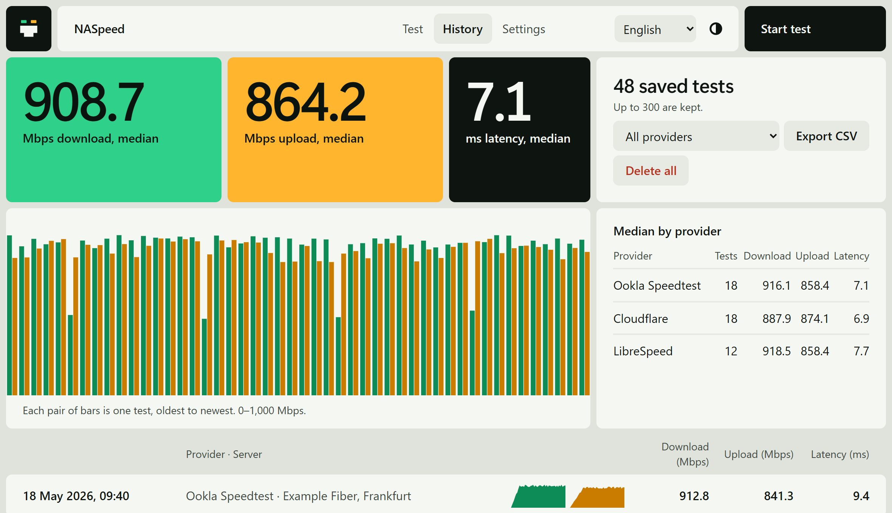

<div align="center">


# NASpeed

### The internet speed test that runs *on your TerraMaster NAS*

Measure the connection your TerraMaster NAS actually gets — not the one your browser sees.

<p>
  
  
  
  
  
  <a href="LICENSE"></a>
</p>

<p>
  <a href="#why-naspeed">Why</a> ·
  <a href="#features">Features</a> ·
  <a href="#providers">Providers</a> ·
  <a href="#how-it-works">How it works</a> ·
  <a href="#getting-started">Getting started</a> ·
  <a href="#permissions-ports-and-files">Permissions</a> ·
  <a href="#license">License</a>
</p>

<picture>
  <source media="(prefers-color-scheme: dark)" srcset=".github/screenshots/test-dark.png">
  
</picture>

<sub>Screenshots show sample data and follow your light or dark theme.</sub>

</div>

> [!IMPORTANT]
> **TOS 7.** TerraMaster listed NASpeed in the App Center. See [Install on TOS 7](#install-on-tos-7)
> to install a package from the [Releases page](https://github.com/ShoraiK/NASpeed/releases).

> [!WARNING]
> **Do not install version 0.2.0 on TOS 7.** Its package fails during installation. Download **0.2.2 or newer**
> from the Releases page instead.

## Why NASpeed?

A speed test in your browser measures the path between *your computer* and the internet. That says very little
about your NAS, which may sit behind a different switch port, VLAN, firewall or uplink — and which is the machine
that actually runs your cloud backups, downloads, sync jobs and remote access.

NASpeed runs the test **on the NAS itself**, so the numbers are the ones your NAS really gets:

- Is my NAS getting the speed my ISP promises?
- Why are my cloud backups slower than the speed test on my laptop?
- Does the line behave differently depending on the provider, the server or the time of day?

## Features

- 🖥️ **Measures from the NAS, not from the browser.** A service on the NAS runs the test; the web UI only controls and displays it.
- 🌐 **Four providers in one place.** Cloudflare, Ookla, LibreSpeed and M-Lab. Pick a provider — and, where supported, a server — for each test, and compare.
- 📊 **The full picture.** Download, upload, idle latency, jitter and latency under load (bufferbloat), with live traces that show the warm-up apart from the measured window.
- ⚡ **Built for fast lines.** Parallel connections scale with the speed observed, and every TLS connection gets its own worker process so Python's GIL does not cap multi-gigabit links.
- 🩺 **Knows when the NAS is the bottleneck.** Every result records the processor load during the measurement and warns when a busy CPU or a CPU quota, not your line, may have held the speed back.
- 🕘 **History you control.** Keep 10 to 1000 results, page through them, switch history off entirely, filter, delete or export to CSV.
- 🎨 **Modern interface.** Light and dark themes, a layout that adapts to narrow windows and six languages: English, Español, Français, Deutsch, Português and 中文. Nothing is loaded from the internet — no CDNs, no web fonts.
- 🔐 **Secure by design.** Access is tied to your TOS session; requests without one are rejected.
- 🧰 **Command line included.** `naspeed test` and `naspeed providers`, with JSON output for scripting.
- 📦 **Zero dependencies.** Pure Python standard library: nothing to compile, nothing to keep up to date.

<div align="center">

<picture>
  <source media="(prefers-color-scheme: dark)" srcset=".github/screenshots/history-dark.png">
  
</picture>

<sub>The history view: medians overall and by provider, one pair of bars per test, and every saved result.</sub>

</div>

## Providers

| Provider | Protocol | Servers | Notes |
|---|---|---|---|
| **Cloudflare** | HTTPS | Automatic — the nearest Cloudflare edge | Nothing to configure |
| **Ookla Speedtest** | HTTP, falling back to HTTPS | Pick from the Speedtest server list; search by name or city | Unofficial protocol — see below |
| **LibreSpeed** | HTTP or HTTPS, as each server offers | Pick from the public LibreSpeed server list | Open-source project |
| **M-Lab NDT7** | WebSocket over TLS | The nearest server, located automatically | One connection, ~10 s per direction. Results are public — see below |

> [!NOTE]
> **Ookla** has no public API. NASpeed speaks the same HTTP protocol as popular third-party clients, which Ookla
> does not endorse and may change or block at any time. If that happens, the other providers are unaffected.

> [!WARNING]
> **M-Lab** publishes the result of every test as open data and keeps it indefinitely, **including your public IP
> address**. The web interface warns you before every M-Lab test until you tick *Don't show this again*, and you can
> turn the warning back on in *Settings > Providers*. The command line refuses to run one unless you add
> `--accept-notice`.

Each provider is a small, self-contained module in [`src/naspeed/providers/`](src/naspeed/providers), so adding another one is straightforward.

## How it works


- **Web UI** — static HTML, CSS and JS with no build step. Inside TOS 7 the platform serves the files and the page opens as a window on the desktop; when you run NASpeed from source, the service serves them itself.
- **Service** — a small Python HTTP server (standard library only). On the NAS it listens on a Unix socket behind the platform proxy; it can also listen on a TCP port, which is how you run it from source.
- **Engine** — runs one test at a time. The main process only coordinates and samples latency; the data itself moves through worker processes (TLS) or threads (plain HTTP), so the measurement never starves the coordinator.
- **Live progress** — the UI polls the service about ten times per second.

### How a test is measured

Every provider is measured with the **same method**, so results are comparable between providers.

| Step | What happens |
|---|---|
| **Server** | Candidate servers are ranked by latency; the best one is used unless you choose another |
| **Latency** | 12 samples of TCP connect time, reported as median, minimum, maximum and jitter |
| **Warm-up** | Connections ramp up first. This phase (at least 1.5 s) is **discarded** |
| **Download / upload** | Bytes are counted over a fixed window of **5 s, 8 s or 15 s** (Quick, Standard, Long) per direction. Speed = bytes × 8 ÷ window length, in decimal Mb/s |
| **Connections** | Scaled automatically — from 4 up to 32, adding more while the speed observed keeps rising, within limits set by the NAS's CPU count — or fixed by you |
| **Under load** | Latency keeps being sampled during the transfers, to expose bufferbloat |
| **NAS load** | The processor is read at the start and end of each window: the whole CPU, its busiest core and NASpeed's own share. The result warns when the CPU reached 90 %, one core 95 %, or a CPU quota held NASpeed back in 5 % of scheduler periods |
| **Payload** | Uploads send random, incompressible data |

Numbers will not necessarily match a provider's own website, which uses its own method.
M-Lab is the exception to the shared method: NDT7 uses a single connection for about ten seconds per direction.

<details>
<summary><strong>Design decisions</strong></summary>

<br>

- **Python standard library only.** Python 3.10 ships with TOS 7, so there is nothing to compile or install and no dependencies to keep up to date.
- **One process per TLS connection.** In a quick loopback feasibility test on a desktop CPU, a single TLS connection reached about 11.7 Gb/s, but several threads in one Python process fell to roughly 3.5–4 Gb/s — most likely because of the GIL. Giving each TLS connection its own process removes that ceiling. Plain-HTTP transfers use threads.
- **A native Deb app, not Docker.** A container would measure through Docker's bridge network, and TOS does not allow Docker apps to use host networking.
- **Polling, not streaming.** The UI polls for live progress because it cannot be assumed that the TOS proxy supports streamed responses.
- **No external resources.** The interface uses the system font and loads nothing from third parties — no CDNs, no web fonts, no analytics — so opening it never sends anything outside your network.

</details>

## Getting started

NASpeed is distributed as a TOS 7 package. The whole application — service and web UI — also runs from source on any machine with **Python 3.10 or newer**, with no dependencies to install.

On first launch, without saved preferences, the interface uses **English** and selects **LibreSpeed**.
Change the language in **Settings**; it is saved on the NAS and restored whenever the app opens.
The provider is remembered when a test starts, not merely when its tile is selected.

### Install on TOS 7

The package is for x86_64 TerraMaster NAS models running TOS 7.

1. On your computer, open the [NASpeed releases page](https://github.com/ShoraiK/NASpeed/releases). Under **Assets** for the newest release, download `naspeed_x86_64.deb`.
2. In your browser, sign in to your NAS with an account that can install apps. Open **App Center** on the TOS desktop.
3. Click **Manual Install** and select the `naspeed_x86_64.deb` file you downloaded. If TOS asks where to install it, choose a volume on the NAS, then confirm the installation.
4. When installation finishes, go to **Installed** in App Center, find **NASpeed** and click **Open**.

To update NASpeed later, repeat these steps with the new `.deb` while the existing version is still installed. Your settings and test history are preserved.

### Run the web UI

From the root of the repository:

**Linux / WSL**

```bash
export PYTHONPATH=src
python3 -m naspeed --dev
```

**Windows (PowerShell)**

```powershell
$env:PYTHONPATH = "src"
python -m naspeed --dev
```

Then open **<http://127.0.0.1:18321>**. Development mode serves the interface straight from `webui/` over plain HTTP on the loopback address, needs no TOS session and keeps its data in `.devdata/`.

### Use the command line

```bash
python3 -m naspeed providers                                 # list the providers
python3 -m naspeed test --provider cloudflare                # run a test
python3 -m naspeed test --provider ookla --list-servers      # list a provider's servers
python3 -m naspeed test --provider librespeed --duration quick --json
python3 -m naspeed test --provider mlab --accept-notice      # M-Lab: accept that the result is public
python3 -m naspeed --version                                 # print the version
```

Run `python3 -m naspeed test --help` to see every option: server, duration, connections, IP version and more.

### Run the tests

```bash
python3 -m unittest discover -s tests
node tests/test_startup.js        # web UI startup and interaction checks, with Node.js
```

The suite runs entirely offline: it needs no internet access and no real speed-test servers. The
[CI workflow](.github/workflows/ci.yml) runs both on every push to `main` and every pull request, with Python 3.10
and the latest Python 3, and also checks that the web UI scripts parse and the package sources are valid.

> [!TIP]
> A speed test moves a lot of data. A Quick test on a 1 Gb/s line transfers roughly 2 GB, and the volume grows with the line speed.

> [!NOTE]
> On Windows, upload speed can read higher than the real figure because the system lacks `TCP_NOTSENT_LOWAT`. Linux is not affected, so use Linux — or the NAS itself — when the upload number matters.

## Project layout

```text
NASpeed/
├── src/naspeed/
│   ├── engine/       Measurement engine: latency, transfers, worker pool
│   ├── providers/    One module per speed-test provider
│   ├── api.py        JSON API
│   ├── auth.py       TOS session and CSRF checks
│   ├── httpd.py      HTTP server over a Unix socket or TCP
│   ├── store.py      Settings and history storage
│   └── cli.py        Command-line interface
├── webui/            Web interface: plain HTML, CSS and JavaScript, no build tooling
├── tests/            Offline test suite
├── packaging/        TOS 7 package files: config.ini, naspeed.lang, DEBIAN/, service, icon
├── tools/build.py    Windows-capable TOS 7 .deb builder
├── .github/          CI and release workflows, README screenshots (sample data)
├── CHANGELOG.md      What changed in each version
└── LICENSE           GNU General Public License v3.0
```

## Security and privacy

- **Tied to your TOS session.** On the NAS the service listens on a Unix socket (mode `0660`) reachable only through the platform proxy. Every request must carry a valid session cookie and a matching CSRF token, or it is rejected with `401`.
- **TCP access.** The service's production TCP listener checks the client network and the Host header. Requests that change state also require a custom header and a matching origin when one is present. Development mode (`--dev`) skips these checks and binds to loopback by default.
- **Hardened static files.** When the service serves the interface itself — in development mode or on a TCP port — it adds a Content-Security-Policy and `X-Content-Type-Options: nosniff`, and blocks path traversal. Inside TOS the platform's own web server serves the interface files, with its own headers.
- **Provider connections.** The interface loads its assets from the NAS. The NAS contacts the selected provider when you look up servers or start a test. See [Third-party APIs](#third-party-apis) or open **Settings → Data and privacy → Provider connections** before either action.
- **Private data.** Settings and history are written atomically with `0600` permissions. History can be capped, switched off or deleted at any time.

### Third-party APIs

Each contacted host sees the public IP of the NAS connection. HTTP and WebSocket requests identify NASpeed and its version. Looking up servers can also open TCP connections to multiple candidates to rank their latency. Download requests specify how much data to send. Uploads contain bytes generated in memory. Your history and settings stay on the NAS. DNS names are resolved through the NAS's configured resolver.

| Provider | Requests and data | Destination |
|---|---|---|
| Cloudflare | HTTPS GET `/meta` (fallback `/cdn-cgi/trace`) returns network and location details. GET `/__down?bytes=…` and POST `/__up?r=…` measure transfers. The requests include the provider's `Referer`. | `speed.cloudflare.com`. Network routing determines which Cloudflare data centre receives the requests. |
| Ookla | HTTPS GET `/speedtest-config.php` and `/api/js/servers` retrieve connection details and the catalogue. The catalogue receives any search text. At the chosen node, GET `/hello`, GET `/download` and POST `/upload` carry probe, size and cache-busting parameters or test bytes. | `www.speedtest.net` for discovery. The test goes to the selected operator and country, over HTTP or HTTPS. This integration uses an unofficial protocol. |
| LibreSpeed | HTTPS GET `/backend-servers/servers.php` retrieves the directory. The chosen node advertises the paths for GET `getIpURL` (public IP and ISP lookup), GET `dlURL` (requested size) and POST `ulURL` (generated bytes). | `librespeed.org` for discovery, then the volunteer or commercial operator of the chosen HTTP or HTTPS node. Location varies by server. |
| M-Lab | HTTPS GET `/v2/nearest/ndt/ndt7` sends `client_name` and `client_version`. A test uses the temporary token supplied by Locate for WSS `/ndt/v7/download` and `/ndt/v7/upload`. | `locate.measurementlab.net`, then the assigned NDT7 node. M-Lab publishes the test IP, timestamp and results as open data indefinitely. Collection and storage can occur in different countries. [M-Lab privacy policy](https://www.measurementlab.net/privacy/) |

For M-Lab, the server picker asks before contacting Locate. This allows a lookup in the current tab. Starting a measurement has its own notice. In the CLI, both listing M-Lab servers and running a test require `--accept-notice`.

## Permissions, ports and files

The following paths and permissions apply to the TOS 7 package. TOS installs apps on a storage volume and links them into
`/usr/local`, so `/usr/local/naspeed` points to a folder such as `/Volume1/@apps/naspeed`. Source development
mode (`--dev`) instead listens on loopback port `18321`, keeps application data in `.devdata/` inside the repository
and writes no log file. Explicit command-line options and `NASPEED_*` environment variables can override paths.

### Permissions

| Permission | Rationale |
|---|---|
| Network: no inbound port | The interface is reached only through the TOS platform proxy, over the Unix socket `/usr/local/naspeed/run/naspeed.sock`, reachable as `/var/api/naspeed.sock` |
| Network: outbound connections | To the provider you pick and its test servers, while a test runs or a server list is loaded — see [Ports](#ports) |
| File system: `/usr/local/naspeed/data/` | Private settings and test history, directory mode `0700`, files `0600` |
| File system: `/usr/local/naspeed/logs/` | Private service log and rotations, directory mode `0700`, files `0600` |
| File system: `/usr/local/naspeed/run/` | Holds the proxy socket. Mode `2710` gives the socket the directory's group (`root`) independently of the service's primary group. The socket itself is `0660`. |
| File system: `/proc/stat` and the service's cgroup `cpu.stat`, read only | Processor load during a test, to tell when the NAS rather than the line may limit the result |
| File system: `/var/api/naspeed.sock` | A symbolic link to the socket. Privileged systemd commands prepare the private `data/`, `logs/` and `run/` directories with restricted permissions once TOS creates the `naspeed` account, ensure the TOS proxy directory exists, and create or remove this link. The application and measurement workers run as `naspeed`. |
| User: `naspeed` (system user) | Isolated service execution — never `root` |
| Shared folder: None | NASpeed never reads or writes your files |

### Ports

The TOS package uses **no listening TCP port**; the platform proxy connects to the Unix socket. Provider
connections below are outbound and start only when you use that provider. Hostname resolution uses the NAS's
configured DNS resolver.

| Port | Protocol | Destination | Purpose |
|---|---|---|---|
| 53 (normally) | UDP or TCP, as configured by the OS | The NAS's DNS resolver | Resolve provider and test-server hostnames |
| 443 | HTTPS | `speed.cloudflare.com` | Cloudflare test |
| 443 | HTTPS | `www.speedtest.net` | Ookla configuration and server list |
| Published by each server, usually 8080 | HTTP, or HTTPS on the same port as a fallback | The Ookla server in use | Ookla test |
| 443 | HTTPS | `librespeed.org` | LibreSpeed server list |
| Published by each server, usually 80 or 443 | HTTP or HTTPS | The LibreSpeed server in use | LibreSpeed test |
| 443 | HTTPS | `locate.measurementlab.net` | Finds the nearest M-Lab server |
| 443 | WebSocket over TLS | The M-Lab server in use | M-Lab test |

Latency is sampled with plain TCP connections to the same server and port.

### Files created at runtime

| Path (relative to `/usr/local/naspeed/data/` unless noted) | Purpose | Format | Created when | Growth bound / rotation | Lifecycle |
|---|---|---|---|---|---|
| `/usr/local/naspeed/data/` | Container for settings and history | Directory | On start, if missing | Contents listed below | Persistent |
| `settings.json` | Your settings — including the interface language and the provider of the last test — and the notices you accepted or chose not to see again | JSON, mode `0600` | First time a setting changes (a test with another provider counts) or a notice is accepted | Typically under 1 KB; not a byte quota | Persistent — survives restarts, upgrades and a normal uninstall |
| `history.json` | Saved test results | JSON, mode `0600` | First saved test, unless history is off; also when history is cleared | Capped by result count (10–1000, default 300), not bytes. A result takes about 1.7 KB: roughly 0.5 MB for 300 or 1.7 MB for 1000; actual sizes vary | Persistent — survives upgrades and a normal uninstall; delete entries or clear it from the History view |
| `<file>.tmp-<pid>` | Atomic write of `settings.json` or `history.json` | JSON | On every save | One per file being saved; renamed over the target at once | Temporary — leftovers from a crash are removed on start |
| `<file>.corrupt` | An unreadable `settings.json` or `history.json`, set aside for inspection | As the original | Only if a file cannot be read | At most one per file; replaced if it happens again | Kept for inspection — safe to delete |
| `/usr/local/naspeed/logs/` | Container for service logs | Directory | On start, if missing | Contents listed below | Persistent |
| `/usr/local/naspeed/logs/naspeed.log` | Service log | Text: `[time] [level] [component] message` | On start | Rotated at 512 KiB, keeping 2 old files (`.1`, `.2`): about 1.5 MiB total | Persistent, rotated |
| `/usr/local/naspeed/run/naspeed.sock` | Socket for the TOS platform proxy | Unix socket, mode `0660` | On start | N/A | Removed on stop; a stale one is replaced on start |
| `/var/api/naspeed.sock` | Link the TOS proxy follows to the socket above | Symbolic link, created by root | On every service start | N/A | Removed on stop |
| `/usr/local/naspeed/webui/` | The interface files that TOS serves at `/naspeed/` | Directory with seven static files | Unpacked from `webui.bz2` by the platform on installation, and again by the package's `postinst` on every upgrade | Fixed, about 169 KB; rewritten on upgrade | Static between upgrades; removed on uninstall |

Inside TOS the platform, not the NASpeed service, serves the interface from that `webui/` folder. The platform only
unpacks it on a fresh installation, which is why `postinst` refreshes it on upgrades. It sends those files without
`Cache-Control`, so a browser may keep an old copy after an upgrade; the interface then notices that its version
differs from the service's and reloads itself once. NASpeed creates no cache
or files in `/tmp`, its measurement workers write no application data, and the command line keeps its results in
memory. The service also logs to stdout, captured by the system journal under systemd. When running Python
directly from source, Python may create ignored `__pycache__/` directories; set `PYTHONDONTWRITEBYTECODE=1` to
disable them. The browser keeps only the theme, a copy of the language (to paint the first frame) and how many results a
History page shows in local storage.

### After uninstalling

Uninstalling from the App Center stops the service and removes its systemd unit, the program, the `webui/` folder,
logs and rotations, temporary and corrupt files, the socket and its proxy link.

- **Keep configuration** (leave the deletion box unticked) to retain `data/settings.json` and `data/history.json` when present. A reinstall reuses them. Saved measurements can include your public IP and internet provider.
- **Delete configuration** (tick the box) to erase those two files as well. A reinstall starts with default settings and empty history.

To keep a copy of your results before deleting them, export them from **History**. Updates preserve settings and history. TOS manages its own package records, caches and the `naspeed` system account.

## Versioning

NASpeed uses plain numeric `MAJOR.MINOR.PATCH` versions, the format the TOS App Center compares to offer updates.
The current version is **1.0.1**. Every version is described in [CHANGELOG.md](CHANGELOG.md).

- The 0.x packages used the TOS beta flag. Stable 1.x packages set that flag to `false`.
- The version is defined once, in [`src/naspeed/__init__.py`](src/naspeed/__init__.py). It appears in Settings,
  in `/api/info`, in `python3 -m naspeed --version` and in every saved result.
- **Releases are automated.** Pushing a raised version to `main` runs the
  [release workflow](.github/workflows/release.yml): it runs the tests, builds the `.deb` and publishes a
  GitHub Release tagged `vMAJOR.MINOR.PATCH` with the package and its SHA-256 checksum. The release is marked
  as a pre-release when `BETA` is `True` and as a regular release when it is `False`.
  A version that already has a tag is never released twice. The release notes start
  with that version's section of [CHANGELOG.md](CHANGELOG.md), whose first line is also the App Center release note.
- **Builds are reproducible.** Every date inside the package comes from the last commit, or from
  `SOURCE_DATE_EPOCH` when it is set, so building a release's commit again in the same environment gives the
  same bytes. A Python linked against a different zlib may compress them differently, but the files inside are
  identical.
- **Review the version before each commit and push of a change or batch.** Increment it when the changes
  warrant a new application version, not automatically for every commit. Use a patch increment for compatible
  fixes and usability or packaging improvements, and a minor increment for significant new functionality
  during the beta. Documentation-only changes, tests and internal refactors without observable changes
  normally do not require an increment.
- When incrementing the version, update the source, this README and [CHANGELOG.md](CHANGELOG.md) together, run
  `python tools/build.py --write-metadata`, verify that the generated package metadata and the executable report
  the same version, and explain the increment in the commit message.

## Development notes

- Code stays compatible with Python 3.10 and uses the standard library only.
- The web interface is plain HTML, CSS and JavaScript and must not load external resources.
- Line endings are LF, enforced by `.gitattributes`.
- `packaging/` holds the TOS 7 metadata exactly as the package installs it: `config.ini`, `naspeed.lang` and
  `DEBIAN/control`. The build generates them from `packaging/developer.json`, the version and the summary line of
  the version in the changelog; run `python tools/build.py --write-metadata` after changing any of those. Building,
  `--validate-only` and the tests fail while a copy is out of date.
- Tests must stay offline.

## License

NASpeed is free software, released under the **GNU General Public License, version 3 only**
([`GPL-3.0-only`](LICENSE)).

You are free to use, study, share and modify it, including commercially. Redistributed copies and modified versions
of NASpeed must retain this license and notices, make the corresponding source available as GPLv3 requires, and
impose no further restrictions on recipients. Repackaging does not permit replacing NASpeed's license; independent
programs merely bundled alongside it keep their own licenses. NASpeed comes **without warranty**. The full terms
are in [LICENSE](LICENSE).

## Disclaimer

NASpeed is an independent project. It is not affiliated with, endorsed by or sponsored by TerraMaster, Ookla, Cloudflare, LibreSpeed or Measurement Lab. All product and company names are trademarks of their respective owners and are used here only to identify the services NASpeed can test against.

<div align="center">

**NASpeed** — know the speed your NAS really gets.

</div>
